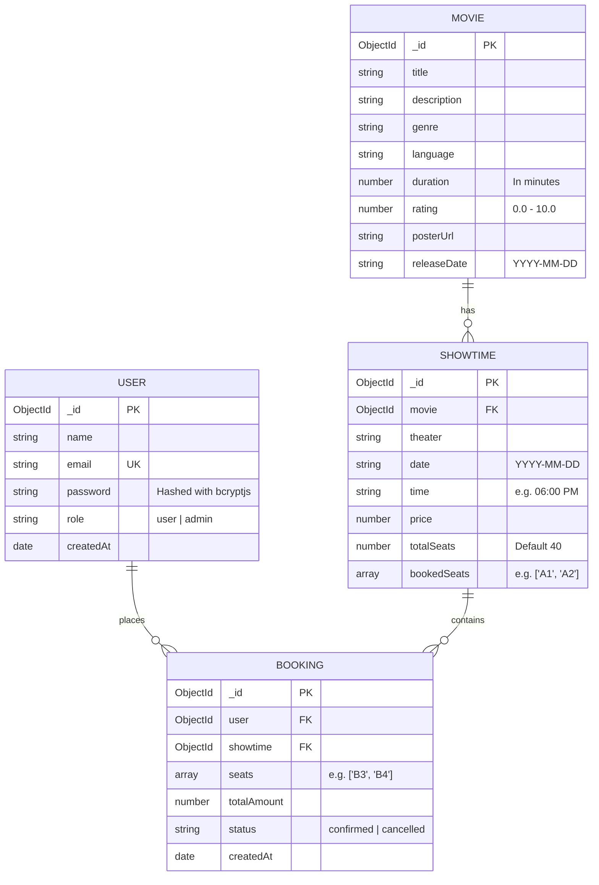

# 🎬 IMovies - Movie Ticket Booking Web Application

**IMovies** is a full-stack MERN (MongoDB, Express.js, React.js, Node.js) web application designed for booking cinema tickets online. Built as a BTech Computer Science course capstone project, it follows a clean MVC (Model-View-Controller) architectural pattern on the backend, implements secure JWT authentication with password hashing, and delivers a responsive, intuitive Bootstrap 5 user interface.

---

## 📌 Table of Contents
1. [Features](#-features)
2. [Tech Stack](#-tech-stack)
3. [Architecture Diagram](#-architecture-diagram)
4. [Entity-Relationship (ER) Diagram](#-entity-relationship-er-diagram)
5. [User Flow & Roles](#-user-flow--roles)
6. [Folder Structure](#-folder-structure)
7. [Environment Variables & Configuration](#-environment-variables--configuration)
8. [Setup & Running Instructions](#-setup--running-instructions)
9. [Database Seeding (With Warning)](#-database-seeding)
10. [Demo Login Credentials](#-demo-login-credentials)
11. [Complete API Reference](#-complete-api-reference)

---

## ✨ Features

### 👤 Customer Features
- **Browse Movies:** Visual grid of currently running films featuring posters, IMDb ratings, runtimes, and languages.
- **Search & Filter:** Real-time search by movie title and instant filtering by genre (Action, Sci-Fi, Adventure, Drama, etc.).
- **Movie Details & Showtimes:** View full synopsis, release date, and theater showtimes scheduled across upcoming dates.
- **Interactive Visual Seating Grid:** 40-seat theater layout (Rows A–E, Columns 1–8) with live color-coded indicators:
  - ⚪ **Available** (Light / Selectable)
  - 🟢 **Selected** (Green / Active)
  - 🔴 **Booked** (Red / Disabled)
- **Real-Time Seat Validation:** Server checks seat availability in real time prior to booking creation to guarantee no double-bookings occur.
- **My Bookings:** View confirmed reservation details and tickets.
- **Instant Cancellation:** Cancel confirmed tickets with 1 click; the server automatically frees reserved seats in real time.

### 🛡️ Admin Features
- **Movie Catalog Management:** Add new movies (title, plot, genre, language, duration, poster image URL, release date) and delete movies.
- **Schedule Showtimes:** Assign movies to theater screens with specific dates, time slots, and ticket prices.
- **View All Platform Bookings:** Comprehensive table displaying all bookings across every customer with user details, seats, status, and revenue.

---

## 🛠 Tech Stack

| Layer | Technology | Description |
| :--- | :--- | :--- |
| **Frontend** | React 19 (Vite) | Fast component-based user interface |
| **Routing** | React Router v7 | Client-side routing with protected route guards |
| **Styling** | Bootstrap 5 + Plain CSS | Responsive cards, forms, tables, and navbar |
| **HTTP Client** | Axios | REST API requests with JWT request interceptor |
| **Backend** | Node.js + Express.js | Modular RESTful API using async/await and MVC |
| **Database** | MongoDB & Mongoose | Object Data Modeling (ODM) with validation |
| **Security** | JWT + bcryptjs | Stateless token auth & salted password hashing |
| **Environment** | dotenv & cors | Environment variable isolation & CORS security |

---

## 🏛 Architecture Diagram

```text
+--------------------------------------------------------------------------+
|                          CLIENT (React 19 / Vite)                        |
|                                                                          |
|   [Navbar]  [Home / Search]  [Movie Details]  [Seat Grid]  [My Bookings] |
|                                   |                                      |
|                              AuthContext                                 |
|                       (JWT stored in localStorage)                       |
|                                   |                                      |
|                            Axios Instance                                |
|                   (Auto-attaches Bearer Token)                           |
+-----------------------------------|--------------------------------------+
                                    | HTTP / JSON REST Requests
                                    v
+--------------------------------------------------------------------------+
|                          SERVER (Node.js / Express)                      |
|                                                                          |
|       server.js (Express Application, CORS, JSON Parser, Port 5000)      |
|                                   |                                      |
|       +---------------------------+---------------------------+          |
|       |                           |                           |          |
|   [authRoutes]              [movieRoutes]             [bookingRoutes]    |
|   /api/auth/*               /api/movies/*             /api/bookings/*    |
|       |                           |                           |          |
|   +---+---------------------------+---------------------------+---+      |
|   | Middleware: auth.js (JWT verify) & adminOnly.js (Role check)  |      |
|   +---+---------------------------+---------------------------+---+      |
|       |                           |                           |          |
|   authController            movieController           bookingController  |
|   showtimeController                                                     |
|       |                           |                           |          |
+-------|---------------------------|---------------------------|----------+
        |                           |                           |
        +---------------------------+---------------------------+
                                    | Mongoose ODM (async / await)
                                    v
+--------------------------------------------------------------------------+
|                            DATABASE (MongoDB)                            |
|                                                                          |
|   - Users Collection      (admin & regular users, hashed passwords)      |
|   - Movies Collection     (title, posterUrl, genre, duration, rating)    |
|   - Showtimes Collection  (theater, date, time, price, bookedSeats[])    |
|   - Bookings Collection   (user ref, showtime ref, seats[], status)      |
+--------------------------------------------------------------------------+
```

---

## 🗄 Entity-Relationship (ER) Diagram



---

## 🔄 User Flow & Roles

### Roles
1. **Regular User (`user`):**
   - Can register an account and log in.
   - Can browse movies, search by title, and filter by genre.
   - Can view showtimes, inspect real-time seat availability, and book tickets.
   - Can view personal booking history and cancel existing bookings.
2. **Administrator (`admin`):**
   - Has all user capabilities.
   - Access to `/admin` protected dashboard.
   - Can add new movies and remove existing movies.
   - Can schedule new showtimes for any movie in the catalog.
   - Can inspect all customer bookings across the platform.

### User Flow
```text
[Visitor] ---> Browse Home Page ---> Search / Filter Movies ---> Select Movie
                     |
                     v
             View Movie Details & Showtimes ---> Select Showtime
                                                      |
                                                      v
                                        Interactive Seat Selection (A1-E8)
                                                      |
                          +---------------------------+---------------------------+
                          | Not Logged In                                         | Logged In
                          v                                                       v
                   Prompted to Login -----------------------------------> Confirm Booking
                                                                                  |
                                                                                  v
                                                                      Real-time Seat Check
                                                                      (Server Prevents Clash)
                                                                                  |
                                                                                  v
                                                                      Success -> [My Bookings]
                                                                                  |
                                                                                  v
                                                                      Option to Cancel Ticket
                                                                      (Seats Released to Pool)
```

---

## 📂 Folder Structure

```text
imovies/
├── .gitignore                      # Git exclusion rules
├── README.md                       # Comprehensive project documentation
├── backend/                        # Express.js REST API Server
│   ├── .env                        # Active local environment variables
│   ├── .env.example                # Example environment variables template
│   ├── package.json                # Backend dependencies and scripts
│   ├── server.js                   # Application entry point & route mounting
│   ├── seed.js                     # Database populator script
│   ├── config/
│   │   └── db.js                   # Mongoose MongoDB connection logic
│   ├── models/
│   │   ├── User.js                 # User schema with password hashing
│   │   ├── Movie.js                # Movie catalog schema
│   │   ├── Showtime.js             # Showtime & bookedSeats schema
│   │   └── Booking.js              # Booking records schema
│   ├── controllers/
│   │   ├── authController.js       # Register, login, me
│   │   ├── movieController.js      # CRUD operations for movies
│   │   ├── showtimeController.js   # Showtime scheduling & lookups
│   │   └── bookingController.js    # Seat reservation & cancellation logic
│   ├── routes/
│   │   ├── authRoutes.js           # Auth endpoint definitions
│   │   ├── movieRoutes.js          # Movie endpoint definitions
│   │   ├── showtimeRoutes.js       # Showtime endpoint definitions
│   │   └── bookingRoutes.js        # Booking endpoint definitions
│   └── middleware/
│       ├── auth.js                 # JWT bearer token authentication guard
│       └── adminOnly.js            # Admin privilege verification guard
└── frontend/                       # React 19 + Vite Client Application
    ├── index.html                  # HTML entry template
    ├── package.json                # Frontend dependencies & scripts
    ├── vite.config.js              # Vite bundler configuration
    └── src/
        ├── main.jsx                # React root mount & Bootstrap CSS import
        ├── App.jsx                 # Client router & protected route tree
        ├── index.css               # Cinema custom styling & hover effects
        ├── api/
        │   └── axios.js            # Axios client with JWT request interceptor
        ├── context/
        │   └── AuthContext.jsx     # User authentication state provider
        ├── components/
        │   ├── Navbar.jsx          # Cinema dark navigation bar
        │   ├── Footer.jsx          # Project credit footer
        │   └── ProtectedRoute.jsx  # Route guard for users & admins
        └── pages/
            ├── Home.jsx            # Movie catalog with search & genre filter
            ├── MovieDetails.jsx    # Movie synopsis & showtimes by date
            ├── SeatSelection.jsx   # 40-seat interactive grid & live price
            ├── MyBookings.jsx      # Booking history & cancellation
            ├── Login.jsx           # Sign-in page with 1-click demo buttons
            ├── Register.jsx        # Account registration page
            └── AdminDashboard.jsx  # Admin panel (Movies, Showtimes, Bookings)
```

---

## ⚙️ Environment Variables & Configuration

The backend reads configuration from `backend/.env`. A reference template is provided at [`backend/.env.example`](backend/.env.example):

```env
PORT=5000
MONGO_URI=mongodb://127.0.0.1:27017/imovies
JWT_SECRET=imovies_secret_key_12345
```

### MongoDB Setup
- **Local MongoDB (Default):** Ensure MongoDB Community Server is running locally. The connection string `mongodb://127.0.0.1:27017/imovies` automatically connects to or creates the `imovies` database.
- **MongoDB Atlas (Cloud):** Replace `MONGO_URI` with your Atlas connection string:
  ```env
  MONGO_URI=mongodb+srv://<username>:<password>@cluster0.mongodb.net/imovies?retryWrites=true&w=majority
  ```

---

## 🚀 Setup & Running Instructions

### 1. Prerequisites
- **Node.js**: v18 or later (tested on v24)
- **MongoDB**: Local MongoDB service running or MongoDB Atlas cluster

### 2. Backend Setup
```powershell
# Open terminal 1 and navigate to backend folder
cd backend

# Install dependencies
npm install

# Start development server
npm run dev
```
*The backend server will start on `http://localhost:5000` and connect to MongoDB.*

### 3. Frontend Setup
```powershell
# Open terminal 2 and navigate to frontend folder
cd frontend

# Install dependencies
npm install

# Start Vite development server
npm run dev
```
*The frontend will run at `http://localhost:5173` (or `http://localhost:5174`). Open this URL in your web browser.*

---

## 🌱 Database Seeding

> [!WARNING]
> **IMPORTANT NOTICE:** Running the seed script **clears all existing records** in your database collections before inserting sample data. Only run this when initializing a fresh database.

To populate your database with initial data:
```powershell
cd backend
npm run seed
```

**What the seed script inserts:**
- **1 Admin user:** `admin@imovies.com` / `admin123`
- **1 Test customer:** `user@imovies.com` / `user123`
- **6 Popular movies:** *Inception*, *Interstellar*, *The Dark Knight*, *Avatar: The Way of Water*, *Spider-Man: Into the Spider-Verse*, *Oppenheimer*.
- **48 Showtimes:** Distributed across upcoming dates over the next 7 days across multiple theaters and screens.
- **1 Sample booking:** Pre-booked seats `['A1', 'A2']` on the first showtime for demo purposes.

---

## 🔑 Demo Login Credentials

For quick and easy evaluation, the login page (`/login`) includes **1-click auto-fill buttons**:

| Account Type | Email | Password | Role | Permissions |
| :--- | :--- | :--- | :--- | :--- |
| **Admin** | `admin@imovies.com` | `admin123` | `admin` | Full access: Add/delete movies, schedule showtimes, view all bookings |
| **Regular User** | `user@imovies.com` | `user123` | `user` | Browse movies, select seats, book tickets, cancel own bookings |

---

## 📡 Complete API Reference

### 1. Authentication Endpoints (`/api/auth`)
| Method | Endpoint | Access | Body Parameters | Description |
| :--- | :--- | :--- | :--- | :--- |
| `POST` | `/api/auth/register` | Public | `{ name, email, password }` | Registers a new user account |
| `POST` | `/api/auth/login` | Public | `{ email, password }` | Validates credentials and returns JWT token |
| `GET` | `/api/auth/me` | User / Admin | *None (Requires Bearer Token)* | Returns profile of authenticated user |

### 2. Movies Endpoints (`/api/movies`)
| Method | Endpoint | Access | Body / Query Parameters | Description |
| :--- | :--- | :--- | :--- | :--- |
| `GET` | `/api/movies` | Public | `?search=term&genre=genre` | List all movies with optional search/filter |
| `GET` | `/api/movies/:id` | Public | *None* | Retrieve full details of a specific movie |
| `GET` | `/api/movies/:id/showtimes`| Public | *None* | List upcoming showtimes for a specific movie |
| `POST` | `/api/movies` | Admin Only | `{ title, description, genre, language, duration, rating, posterUrl, releaseDate }` | Create and publish a new movie |
| `PUT` | `/api/movies/:id` | Admin Only | `{ ...updatedFields }` | Update movie details |
| `DELETE` | `/api/movies/:id` | Admin Only | *None* | Remove movie and its related showtimes |

### 3. Showtimes Endpoints (`/api/showtimes`)
| Method | Endpoint | Access | Body Parameters | Description |
| :--- | :--- | :--- | :--- | :--- |
| `GET` | `/api/showtimes/:id` | Public | *None* | Retrieve showtime details and current `bookedSeats` |
| `POST` | `/api/showtimes` | Admin Only | `{ movie, theater, date, time, price, totalSeats }` | Schedule a new showtime |

### 4. Bookings Endpoints (`/api/bookings`)
| Method | Endpoint | Access | Body Parameters | Description |
| :--- | :--- | :--- | :--- | :--- |
| `POST` | `/api/bookings` | User / Admin | `{ showtimeId, seats: ["A1", "A2"] }` | Reserves seats with real-time conflict verification |
| `GET` | `/api/bookings/my` | User / Admin | *None (Requires Bearer Token)* | Retrieves all bookings for the logged-in user |
| `PUT` | `/api/bookings/:id/cancel` | User / Admin | *None (Requires Bearer Token)* | Cancels booking and releases seats back to showtime |
| `GET` | `/api/bookings` | Admin Only | *None (Requires Admin Token)* | Returns all platform bookings across all customers |
